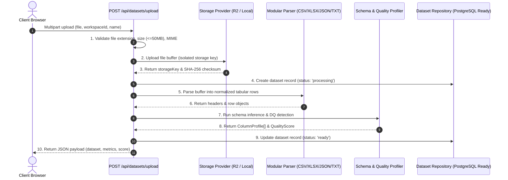

# Data Ingestion Architecture — TraceImpact Cloud Day 2

## 1. Overview
The Data Ingestion Engine is the entry point for all datasets in TraceImpact Cloud. It accepts raw files in supported formats (CSV, XLSX, JSON, TXT), validates metadata, isolates storage by workspace and dataset, and orchestrates downstream parsing, schema inference, and data profiling.

---

## 2. Ingestion Pipeline Sequence

---

## 3. Ingestion Validation Rules
1. **Extension Check:** Strict whitelist matching (`csv`, `xlsx`, `json`, `txt`).
2. **File Size Enforcement:** Free tier maximum capped at 50 MB (52,428,800 bytes).
3. **MIME Verification:** Sanity checking MIME against known file signatures.
4. **Filename Sanitization:** Path traversal tokens (`..`, `/`, `\`) and null bytes (`\0`) are stripped before storage key generation.
5. **Multi-Tenant Scoping:** Ingested datasets require a valid `workspaceId` (defaults to `default-workspace` during development).
