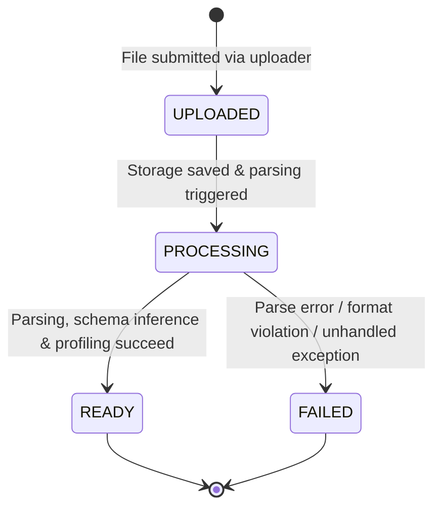

# Dataset Processing Lifecycle & States — TraceImpact Cloud Day 2

## 1. Lifecycle State Machine

---

## 2. State Definitions
- **`uploaded`:** File metadata is stored; storage buffer is recorded.
- **`processing`:** Parser is streaming file and profiler is computing metrics.
- **`ready`:** Parsing and profiling completed successfully; columns, quality score, and issues are persisted.
- **`failed`:** Processing encountered an error; `errorMessage` is recorded and displayed to the user.
