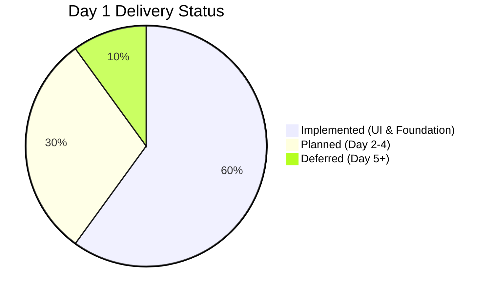
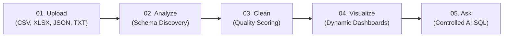
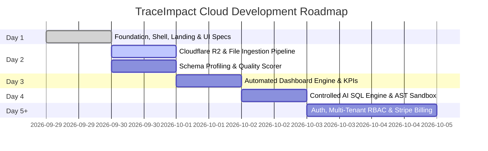
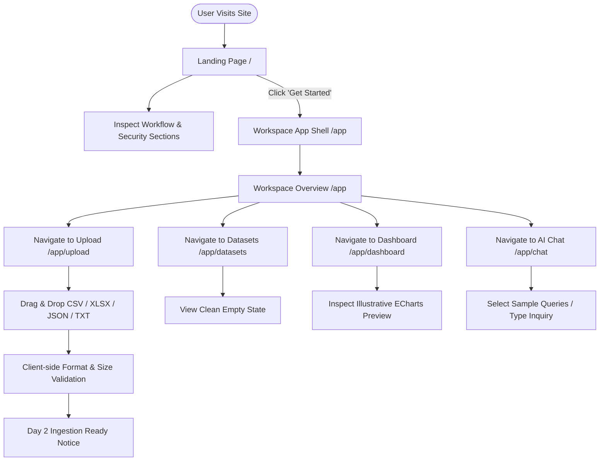
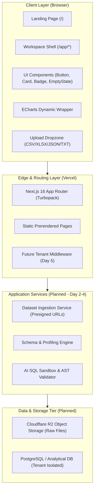
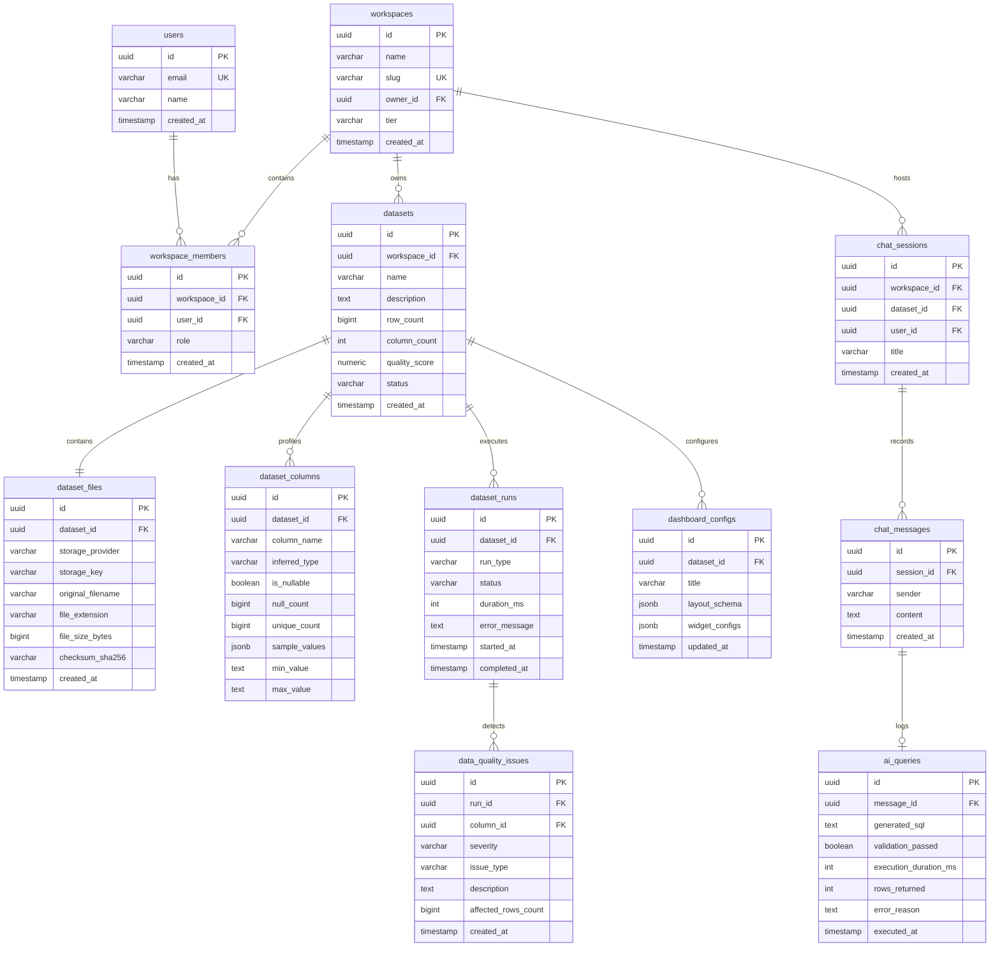
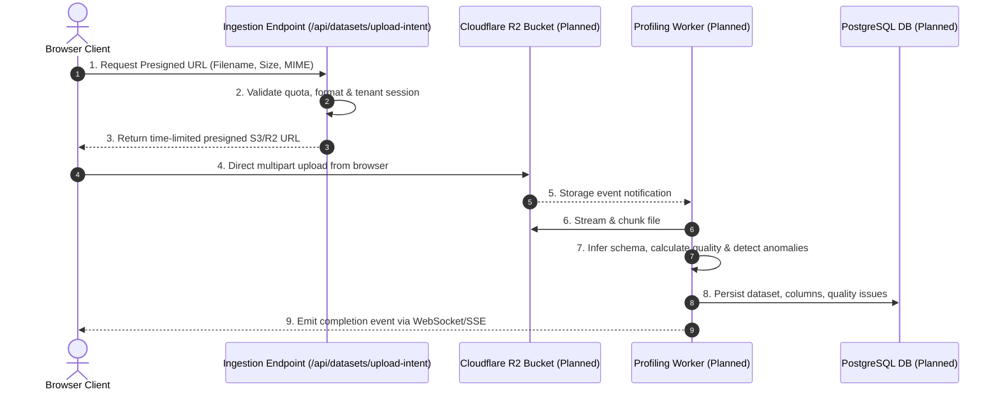

# TraceImpact Cloud — Day 1 Complete Documentation

> **Canonical Consolidated Reference Document**  
> **Project:** TraceImpact Cloud  
> **Milestone:** Day 1 Foundation  
> **Consolidation Date:** 2026-09-29  
> **Status:** `COMPLETE`  

---

## 1. Document Purpose

This document serves as the single authoritative, consolidated reference for the Day 1 architecture, product specifications, design system, user flows, database design, security model, and implementation records for **TraceImpact Cloud**.

### Source Documents Consolidated
This canonical document unifies and synthesizes all 12 modular Day 1 specification documents created during milestone execution:
1. `docs/01_PRODUCT_REQUIREMENTS.md` (Product Requirements Document)
2. `docs/02_SAAS_SCOPE.md` (SaaS Scope & Release Phasing)
3. `docs/03_USER_FLOWS.md` (User Flows & Interaction Models)
4. `docs/04_SYSTEM_ARCHITECTURE.md` (System Architecture)
5. `docs/05_TECH_STACK.md` (Technology Stack Specification)
6. `docs/06_DATABASE_DESIGN.md` (Logical Database Design)
7. `docs/07_STORAGE_ARCHITECTURE.md` (Storage Architecture & Ingestion Pipeline)
8. `docs/08_SECURITY_MODEL.md` (Security Architecture & Controlled SQL Model)
9. `docs/09_FILE_SUPPORT_MATRIX.md` (File Support Matrix V1)
10. `docs/10_DAY_1_IMPLEMENTATION.md` (Day 1 Implementation Report)
11. `docs/11_DAY_1_TEST_REPORT.md` (Day 1 Test Report & Validation)
12. `docs/12_DAY_1_DECISIONS.md` (Architectural & Engineering Decisions)
13. `PROJECT_STATUS.md` & `CHANGELOG.md` (Milestone & Changelog records)

---

## 2. Day 1 Executive Summary

### Milestone Objective
Day 1 focused on establishing the core foundation of TraceImpact Cloud:
- Inspecting the initial Next.js project setup and dependencies without disturbing configuration.
- Designing and implementing the public marketing landing page.
- Establishing the responsive application shell layout (desktop sidebar + mobile drawer).
- Implementing all core App Router workspace routes (`/app`, `/app/datasets`, `/app/upload`, `/app/dashboard`, `/app/chat`).
- Developing reusable UI design system primitives and an SSR-safe Apache ECharts client component.
- Creating the complete architectural, database, security, and storage specifications.
- Validating the codebase with strict linting, TypeScript typing, and production static site builds.

### Status Classification



| Area | Implementation Status | Milestone |
|---|---|---|
| **Public Landing Page & Navigation** | `IMPLEMENTED` | Day 1 |
| **Application Shell (`/app/*`)** | `IMPLEMENTED` | Day 1 |
| **Workspace Overview (`/app`)** | `IMPLEMENTED` | Day 1 |
| **Dataset Catalog Empty State (`/app/datasets`)** | `IMPLEMENTED` | Day 1 |
| **Interactive File Dropzone & Validation (`/app/upload`)**| `IMPLEMENTED` | Day 1 |
| **Dashboard Placeholder & ECharts Preview (`/app/dashboard`)** | `IMPLEMENTED` | Day 1 |
| **AI Data Chat UI (`/app/chat`)** | `IMPLEMENTED` | Day 1 |
| **Design System & Primitives (`Button`, `Card`, `Badge`, `EmptyState`)** | `IMPLEMENTED` | Day 1 |
| **Client ECharts Lifecycle Wrapper** | `IMPLEMENTED` | Day 1 |
| **Cloudflare R2 Object Storage & Ingestion Pipeline** | `PLANNED` | Day 2 |
| **Streaming File Parser & Schema Profiler Worker** | `PLANNED` | Day 2 |
| **Relational Database Schema (PostgreSQL)** | `PLANNED` | Day 2 |
| **Automated Dynamic Dashboard Generator** | `PLANNED` | Day 3 |
| **Controlled AI SQL Engine & AST Validator** | `PLANNED` | Day 4 |
| **User Authentication, RBAC & Billing** | `DEFERRED` | Day 5+ |

---

## 3. Product Overview

### Core Concept & Problem Statement
Raw tabular datasets (CSV, Excel, JSON, delimited text) are frequently messy, unstructured, inconsistent, and difficult for non-technical users to analyze without manual spreadsheet manipulation or writing custom scripts. 

**TraceImpact Cloud** solves this problem by providing an autonomous, multi-tenant SaaS data platform that profiles ingested data, audits data health, flags anomalies, generates personalized visualizations, and enables plain-English natural-language conversations with datasets via a strictly sandboxed, read-only SQL engine.

### Core Value Propositions
- **Primary Message:** *"Turn messy data into clear, trustworthy answers."*
- **Supporting Proposition:** *"Upload your data, automatically understand its structure and quality, explore personalized dashboards, and ask questions about your data in plain English."*

### Primary End-to-End Workflow



---

## 4. SaaS Scope & Release Roadmap



### In Scope (Day 1 `IMPLEMENTED`)
- Next.js 16 App Router hierarchy (`/`, `/app`, `/app/datasets`, `/app/upload`, `/app/dashboard`, `/app/chat`).
- Responsive layout with desktop persistent sidebar and mobile collapsible navigation drawer.
- Component library: `Button`, `Card`, `Badge`, `EmptyState`, `Navbar`, `Footer`, `AppSidebar`, `AppHeader`.
- Reusable, browser-safe `EChartsChart` component with automatic container resize observers.
- Stateful file upload interface supporting `.csv`, `.xlsx`, `.json`, `.txt` with real-time metadata calculation (name, MIME, byte size) and clear disabled processing triggers.
- Transparent telemetry placeholders for datasets, rows analyzed, quality score, and questions answered.
- Comprehensive technical documentation suite.

### Out of Scope & Deferred (Day 2+)
- Live backend databases and ORM connections.
- Cloudflare R2 bucket integration and presigned upload URLs.
- Server-side background worker threads and chunked stream parsers.
- Dynamic dataset-to-chart rendering pipelines.
- AI LLM integrations and SQL execution engines.
- Production authentication providers (Supabase Auth / NextAuth / Clerk).

### Scope Boundaries & Anti-Goals
- **No Direct SQL Execution from Frontend:** Clients will never submit raw SQL to the database.
- **No Unrestricted LLM Tooling:** The AI engine will never possess direct, unvalidated database connection privileges.
- **No Fabricated Data or Metrics:** All Day 1 statistics are explicitly labeled as placeholders or illustrative previews.

---

## 5. User Flows & Journeys



### Detailed Journey Breakdown

#### 1. Public Visitor Onboarding (`/`)
- User reviews the value proposition, 5-stage workflow cards, feature breakdown, 4-step process, and security architecture.
- User clicks "Get started" or "Create your workspace" and is routed to `/app`.

#### 2. Workspace Overview & Exploration (`/app`)
- User views the telemetry dashboard with 4 metric cards (*Datasets: 0, Rows analyzed: 0, Data quality score: —, Questions answered: 0*).
- User selects quick-action links to proceed to dataset ingestion, dashboard preview, or AI chat.

#### 3. Dataset Ingestion (`/app/upload`)
- User drags and drops or browses a `.csv`, `.xlsx`, `.json`, or `.txt` file.
- The UI computes file metadata (name, MIME type, formatted size in bytes).
- The uploader presents the active format matrix and a disabled button indicating Day 2 ingestion activation.

#### 4. Dashboard & Visualizations (`/app/dashboard`)
- User inspects the analytics roadmap and interacts with an ECharts bar chart demonstration explicitly labeled *"Illustrative preview"*.

#### 5. AI Data Chat (`/app/chat`)
- User views sample exploration queries and the query prompt bar with security guarantees.

---

## 6. System Architecture



---

## 7. Technology Stack Specification

### Verified Core Stack (Day 1)

| Layer | Technology | Exact Version | Configuration & Purpose |
|---|---|---|---|
| **Framework** | Next.js | `16.3.7` | App Router, Turbopack, React Server/Client Components |
| **UI Library** | React & React-DOM | `19.2.8` | React 19 architecture, hooks, JSX runtime |
| **Language** | TypeScript | `^5.0.0` | Strict type checking (`strict: true`), `@/*` path aliases |
| **Styling** | Tailwind CSS | `^4.0.0` | `@tailwindcss/postcss`, `@theme inline` design tokens |
| **Visualizations** | Apache ECharts | `^6.1.0` | Browser-safe canvas data visualization component |
| **Linting** | ESLint | `^9.0.0` | `eslint-config-next` 16.3.7, Core Web Vitals & TypeScript rules |
| **Deployment** | Vercel | Production | Static prerendering, serverless edge hosting |
| **Version Control** | Git / GitHub | v2.x | Source management |

---

## 8. Logical Database Design (PostgreSQL)

> **Status Notice:** This logical data model defines the schema structure for Day 2+ implementation. No fake records or active database connections are instantiated on Day 1.



---

## 9. Storage Architecture & Ingestion Pipeline



### Storage Organization Hierarchy
```
r2://traceimpact-datasets/
  └── workspaces/
      └── {workspace_id}/
          └── datasets/
              └── {dataset_id}/
                  ├── raw/
                  │   └── {file_uuid}_{original_filename}
                  └── processed/
                      └── clean_dataset.parquet (Day 3+)
```

---

## 10. Security Architecture & Controlled SQL Model

```mermaid
flowchart TD
    UserQ["1. User Plain-English Question"] --> PromptGen["2. Context & Schema Assembly (Sanitized Column Metadata)"]
    PromptGen --> AISQL["3. AI Intent & SQL Generation"]
    AISQL --> ASTCheck{"4. Server-Side AST & Lexical Validator"}
    
    ASTCheck -->|Contains Prohibited Syntax<br/>(DROP, DELETE, UPDATE, etc.)| Reject["5a. REJECT & Log Security Event"]
    ASTCheck -->|References Unknown/Cross-Tenant Tables| Reject
    ASTCheck -->|Multi-statement / Semicolon / Comment Bypass| Reject
    
    ASTCheck -->|Valid Read-Only SELECT| Execute["5b. Scoped Read-Only Execution (Dedicated DB Role)"]
    Execute --> Result["6. Tabular Result Set (Max 5,000ms Timeout)"]
    Result --> Synthesis["7. AI Natural Explanation + Chart Recommendation"]
    Synthesis --> Display["8. Display Answer to User"]
```

### Prohibited Commands & Injection Vectors Whitelist Policy
- **Prohibited Data Mutation:** `DROP`, `DELETE`, `UPDATE`, `INSERT`, `ALTER`, `TRUNCATE`, `CREATE`, `REPLACE`, `MERGE`, `UPSERT`.
- **Prohibited Privilege Commands:** `GRANT`, `REVOKE`, `EXECUTE`, `CALL`, `SET`, `RESET`, `SHOW`, `DESCRIBE`, `COPY`.
- **Prohibited Bypass Vectors:** Multi-statement queries (`;`), inline SQL comment tokens (`--`, `/* ... */`), system catalog access (`pg_*`, `information_schema`), and cross-workspace schema references.

---

## 11. File Support Matrix (V1)

| Format | Extension | Declared MIME Types | Free / Pro Size Limit | Delimiter / Parser Strategy |
|---|---|---|---|---|
| **Comma-Separated Values** | `.csv` | `text/csv`, `application/csv`, `text/plain` | 50 MB / 500 MB | Streaming CSV parser with auto-header inference |
| **Excel Workbooks** | `.xlsx` | `application/vnd.openxmlformats-officedocument.spreadsheetml.sheet` | 50 MB / 250 MB | OpenXML workbook parser with multi-sheet detection |
| **JSON Records** | `.json` | `application/json`, `text/json` | 50 MB / 250 MB | Streaming JSON parser for arrays of records |
| **Delimited Text** | `.txt` | `text/plain` | 50 MB / 250 MB | Heuristic delimiter resolution (Tab, Pipe, Semicolon) |

---

## 12. Day 1 Implementation Details

### Route Catalog

| Route | Pre-render Mode | File Path | Key Features |
|---|---|---|---|
| `/` | Static (`○`) | [app/page.tsx](file:///Users/shashwat/Desktop/traceimpact-cloud/app/page.tsx) | Marketing Navbar, Hero, 5-stage workflow cards, Feature grid, 4-step process, Security section, Footer |
| `/app` | Static (`○`) | [app/app/page.tsx](file:///Users/shashwat/Desktop/traceimpact-cloud/app/app/page.tsx) | Workspace overview banner, 4 telemetry placeholder metric cards, Quick-start launchpad |
| `/app/datasets` | Static (`○`) | [app/app/datasets/page.tsx](file:///Users/shashwat/Desktop/traceimpact-cloud/app/app/datasets/page.tsx) | Dataset catalog header, empty state illustration, upload CTA |
| `/app/upload` | Static (`○`) | [app/app/upload/page.tsx](file:///Users/shashwat/Desktop/traceimpact-cloud/app/app/upload/page.tsx) | Interactive drag-and-drop dropzone, file metadata calculator, V1 format matrix, disabled Day 2 button |
| `/app/dashboard`| Static (`○`) | [app/app/dashboard/page.tsx](file:///Users/shashwat/Desktop/traceimpact-cloud/app/app/dashboard/page.tsx) | Analytics roadmap cards, live ECharts visualization with "Illustrative preview" banner |
| `/app/chat` | Static (`○`) | [app/app/chat/page.tsx](file:///Users/shashwat/Desktop/traceimpact-cloud/app/app/chat/page.tsx) | Conversational chat stream, suggested exploration prompts, query input bar, security guarantees |

### Component Architecture
- **Layout:** [Navbar.tsx](file:///Users/shashwat/Desktop/traceimpact-cloud/components/layout/Navbar.tsx), [Footer.tsx](file:///Users/shashwat/Desktop/traceimpact-cloud/components/layout/Footer.tsx), [AppSidebar.tsx](file:///Users/shashwat/Desktop/traceimpact-cloud/components/layout/AppSidebar.tsx), [AppHeader.tsx](file:///Users/shashwat/Desktop/traceimpact-cloud/components/layout/AppHeader.tsx), [layout.tsx](file:///Users/shashwat/Desktop/traceimpact-cloud/app/app/layout.tsx).
- **UI Primitives:** [Button.tsx](file:///Users/shashwat/Desktop/traceimpact-cloud/components/ui/Button.tsx), [Card.tsx](file:///Users/shashwat/Desktop/traceimpact-cloud/components/ui/Card.tsx), [Badge.tsx](file:///Users/shashwat/Desktop/traceimpact-cloud/components/ui/Badge.tsx), [EmptyState.tsx](file:///Users/shashwat/Desktop/traceimpact-cloud/components/ui/EmptyState.tsx).
- **Charts:** [EChartsChart.tsx](file:///Users/shashwat/Desktop/traceimpact-cloud/components/charts/EChartsChart.tsx) (Dynamic client wrapper with `ResizeObserver` and `dispose()` cleanup).
- **Configuration & Types:** [config/site.ts](file:///Users/shashwat/Desktop/traceimpact-cloud/config/site.ts), [types/index.ts](file:///Users/shashwat/Desktop/traceimpact-cloud/types/index.ts), [lib/utils.ts](file:///Users/shashwat/Desktop/traceimpact-cloud/lib/utils.ts).

---

## 13. Testing & Quality Assurance Report

### Test Execution Summary

| Test Suite | Command | Result | Notes |
|---|---|---|---|
| **ESLint Validation** | `npm run lint` | **`PASSED`** | 0 errors, 0 warnings across all `.ts` and `.tsx` files |
| **Next.js Production Build** | `npm run build` | **`PASSED`** | Compiled via Turbopack; all 7 routes prerendered statically |
| **TypeScript Strict Checking** | TypeScript Compiler | **`PASSED`** | Zero type errors, strict null checks enforced |
| **ECharts SSR & Hydration** | Dynamic Canvas Init | **`PASSED`** | Browser-safe initialization without hydration mismatches |
| **Responsive Viewports** | Desktop, Tablet, Mobile | **`PASSED`** | Mobile drawer functional; zero horizontal overflow |

---

## 14. Architectural & Engineering Decisions

1. **Nested App Router Shell Layout (`/app/*`):** Kept public landing page (`/`) isolated from authenticated application shell (`/app/layout.tsx`) to optimize asset delivery and clean routing boundaries.
2. **Pure Client-Safe ECharts Wrapper:** Encapsulated ECharts inside `'use client'` component with `useRef` and `ResizeObserver` to eliminate SSR canvas errors and prevent memory leaks.
3. **Single Source of Truth for Design Tokens:** Consolidated route definitions, supported file formats, and metadata into `config/site.ts` paired with Tailwind CSS v4 variables.
4. **Transparent Placeholders & Defense-in-Depth:** Prevented premature database mocks and clearly labeled all illustrative charts and future actions to maintain engineering integrity.

---

## 15. Documentation Consistency Analysis

Across all 12 Day 1 specification documents and implementation files:
- **Terminology Alignment:** Universal consistency across core concepts (*Workspaces, Datasets, Columns, Runs, Issues, Controlled SQL*).
- **Format Parity:** CSV, XLSX, JSON, and TXT are uniformly defined as the 4 supported V1 formats across PRD, UI, and Storage documentation.
- **Security Invariants:** The AST SQL validator and read-only execution constraints match across PRD, Architecture, and Security specifications.
- **No Contradictions Found:** All 12 source files are mutually compatible and in full agreement.

---

## 16. Exact Next Step for Day 2

**Day 2 Objective:**  
Implement the dataset ingestion pipeline, Cloudflare R2 object storage integration with presigned URLs, streaming file parsers (CSV, XLSX, JSON, TXT), schema inference worker, and automated data quality scoring algorithm.
