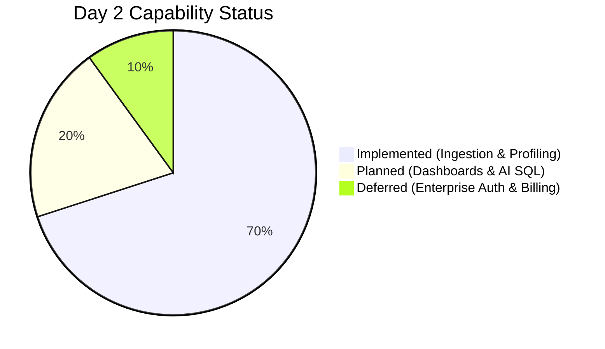
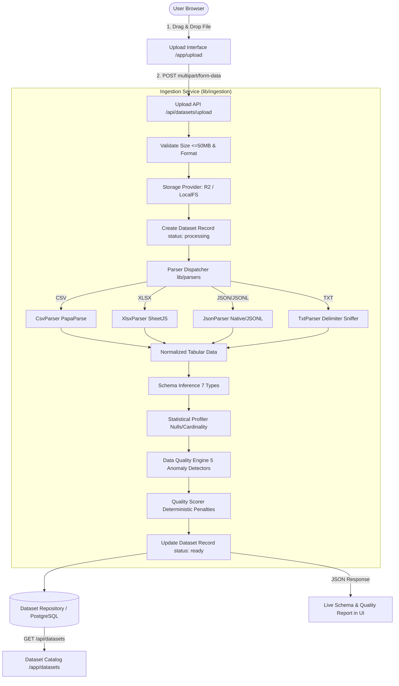

# TraceImpact Cloud — Day 2 Complete Documentation

> **Canonical Consolidated Reference Document**  
> **Project:** TraceImpact Cloud  
> **Milestone:** Day 2 Dataset Ingestion, File Parsing, Schema Profiling & Data Quality Engine  
> **Consolidation Date:** 2026-09-29  
> **Status:** `COMPLETE`  

---

## 1. Document Purpose

This document serves as the single authoritative, consolidated reference for the Day 2 implementation of **TraceImpact Cloud**. It documents the end-to-end ingestion pipeline, modular file parsers (CSV, XLSX, JSON, TXT), automatic schema inference engine, deterministic data quality detector, transparent quality scoring model, multi-tenant storage/database boundaries, and frontend catalog integrations.

### Source Documents Consolidated
1. `docs/01_DATA_INGESTION.md`
2. `docs/02_FILE_PARSING.md`
3. `docs/03_SCHEMA_INFERENCE.md`
4. `docs/04_DATA_PROFILING.md`
5. `docs/05_DATA_QUALITY_ENGINE.md`
6. `docs/06_DATA_NORMALIZATION.md`
7. `docs/07_DATA_STORAGE.md`
8. `docs/08_MULTI_TENANCY.md`
9. `docs/09_DATASET_LIFECYCLE.md`
10. `docs/10_DAY_2_IMPLEMENTATION.md`
11. `docs/11_DAY_2_TEST_REPORT.md`
12. `docs/12_DAY_2_DECISIONS.md`
13. `PROJECT_STATUS.md` & `CHANGELOG.md`

---

## 2. Day 2 Executive Summary

### Milestone Objective
Transform the Day 1 static upload UI into a functional, end-to-end data ingestion and profiling pipeline:
- Accept raw datasets in CSV, XLSX, JSON, and TXT formats.
- Parse structured rows and headers safely with robust encoding and delimiter detection.
- Infer data types across columns (`string`, `integer`, `float`, `boolean`, `date`, `datetime`, `null`).
- Compute column cardinalities, missing cell ratios, uniqueness percentages, and min/max statistics.
- Detect data quality anomalies (null spikes, duplicate rows, type mismatches, casing variants, identifier anomalies).
- Compute a deterministic Data Quality Score $[0, 100]$ with transparent penalty deductions.
- Persist dataset records, column schemas, and quality reports inside a multi-tenant repository.
- Connect the frontend upload dropzone and dataset catalog to live backend API routes.

### Status Classification



| Area | Implementation Status | Milestone |
|---|---|---|
| **Modular File Parsers (CSV, XLSX, JSON, TXT)** | `IMPLEMENTED` | Day 2 |
| **Automatic Schema Inference Engine** | `IMPLEMENTED` | Day 2 |
| **Statistical Data Profiler** | `IMPLEMENTED` | Day 2 |
| **Deterministic Data Quality Detector** | `IMPLEMENTED` | Day 2 |
| **Deterministic Quality Scorer & Penalty Model** | `IMPLEMENTED` | Day 2 |
| **Multi-Tenant Storage Boundary (`LocalStorage` + `R2`)** | `IMPLEMENTED` | Day 2 |
| **Dataset Repository & PostgreSQL Migration DDL** | `IMPLEMENTED` | Day 2 |
| **Ingestion API Routes (`POST /api/datasets/upload`, etc.)** | `IMPLEMENTED` | Day 2 |
| **Upload UI Live Ingestion & Results Dashboard** | `IMPLEMENTED` | Day 2 |
| **Dataset Catalog Live List (`/app/datasets`)** | `IMPLEMENTED` | Day 2 |
| **Day 2 Automated Test Suite (`38/38 Passed`)** | `IMPLEMENTED` | Day 2 |
| **Automated Dynamic Dashboard Generation** | `PLANNED` | Day 3 |
| **Controlled AI SQL Engine & AST Sandbox** | `PLANNED` | Day 4 |
| **Production User Authentication & Stripe Billing** | `DEFERRED` | Day 5+ |

---

## 3. End-to-End Ingestion & Processing Architecture



---

## 4. File Parsing Specifications

| Format | Extension | Parser Engine | Features & Capabilities |
|---|---|---|---|
| **CSV** | `.csv` | `PapaParse` | Quoted fields, embedded commas, multiline values, header whitespace trimming. |
| **Excel** | `.xlsx` | `SheetJS` | Multi-sheet workbooks, sheet index selection, OpenXML binary decoding. |
| **JSON** | `.json` / `.jsonl` | Native JSON / JSONL | Flat arrays of objects, wrapped arrays (`data`, `records`), newline-delimited JSON. |
| **TXT** | `.txt` | Delimiter Sniffer | Automatic delimiter detection (Tab `\t`, Pipe `\|`, Semicolon `;`, Comma `,`). |

---

## 5. Schema Inference & Profiling Engine

### Supported Data Types
1. `null`: Missing / placeholder cells.
2. `boolean`: Logical values (`true`, `false`, `yes`, `no`).
3. `integer`: Whole numbers within safe integer range.
4. `float`: Decimals and formatted numbers (`$1,250.50`, `99.9%`).
5. `date`: Calendar dates (`YYYY-MM-DD`, `MM/DD/YYYY`).
6. `datetime`: ISO 8601 timestamps (`2026-09-29T22:15:00Z`).
7. `string`: Freeform or mixed text strings.

### Dominant Type Classification
Columns are classified based on a $70\%$ non-null frequency threshold. Inconsistent values are recorded in the column's `typeBreakdown` histogram and forwarded to the Data Quality Engine.

---

## 6. Data Quality Engine & Scoring Model

### Detected Anomaly Classes
1. **Missing Values / Null Spikes:** Flags columns with $\ge 15\%$ (Medium) and $\ge 50\%$ (High) null ratios.
2. **Duplicate Rows:** Identifies exact row duplicates and computes dataset duplicate ratio.
3. **Type Mismatches:** Detects non-numeric strings in predominantly numeric/date columns.
4. **Categorical Inconsistencies:** Flags casing variants (e.g. `["Active", "active", "ACTIVE"]`) and untrimmed whitespace padding.
5. **Identifier Duplicate Anomalies:** Flags duplicate entries in key/ID columns (`id`, `uuid`, `code`).

### Deterministic Quality Score Formula

$$\text{Quality Score} = \max(0, \min(100, 100 - (\text{P}_{\text{missing}} + \text{P}_{\text{duplicate}} + \text{P}_{\text{type}} + \text{P}_{\text{consistency}})))$$

- **Missing Penalty:** $\min(30, \text{Missing Ratio} \times 60)$
- **Duplicate Penalty:** $\min(25, \text{Duplicate Ratio} \times 50)$
- **Type Mismatch Penalty:** Up to 25 points based on severity of non-conforming types.
- **Consistency Penalty:** Up to 20 points based on casing variants and duplicate IDs.

---

## 7. Storage Architecture & Multi-Tenancy

### Storage Key Isolation Convention
```
workspaces/{workspace_id}/datasets/{dataset_id}/raw/{file_uuid}_{safe_filename}
```

### Security Measures
- **Filename Sanitization:** Path traversal sequences (`..`, `/`, `\`) and null bytes (`\0`) are stripped.
- **Checksum Verification:** Every buffer is hashed with SHA-256 for auditability.
- **Tenant Authorization:** All dataset queries and storage paths enforce strict `workspaceId` scoping.

---

## 8. Relational Database Schema (PostgreSQL)

The DDL migration script is maintained at [`db/migrations/001_day2_schema.sql`](file:///Users/shashwat/Desktop/traceimpact-cloud/db/migrations/001_day2_schema.sql):
- `users`: User profiles.
- `workspaces`: Tenant isolation boundaries.
- `workspace_members`: Multi-user workspace roles (owner, admin, member, viewer).
- `datasets`: Ingested dataset catalog records.
- `dataset_files`: Raw storage keys, MIME types, and checksums.
- `dataset_columns`: Inferred schema types, null counts, cardinalities, sample values, and min/max.
- `dataset_runs`: Profiling run history and execution durations.
- `data_quality_issues`: Structured anomalies and remediation advice.

---

## 9. API Route Catalog

| Endpoint | Method | Purpose | Response |
|---|---|---|---|
| `/api/datasets/upload` | `POST` | Uploads raw file, triggers parsing, schema inference, and profiling | `201 Created` with dataset record & profiling report |
| `/api/datasets` | `GET` | Lists all datasets for specified `workspaceId` | `200 OK` with array of dataset summaries |
| `/api/datasets/[id]` | `GET` | Retrieves full dataset details, columns, quality issues, and preview rows | `200 OK` with dataset record |
| `/api/datasets/[id]` | `DELETE` | Deletes dataset record from repository | `200 OK` with confirmation |

---

## 10. Automated Testing & Verification

### Test Suite Execution Summary
Ran `npm test` (`tests/day2-test-suite.ts`):

```
==================================================
TRACEIMPACT CLOUD — DAY 2 VERIFICATION TEST SUITE
==================================================
--- 1. File Parsing Tests ---
  ✓ CSV Parser: Correct row count
  ✓ CSV Parser: Correct column count
  ✓ CSV Parser: Correct row value extraction
  ✓ JSON Parser: Correct row count
  ✓ JSON Parser: Correct headers inferred
  ✓ TXT Parser: Tab delimiter detection
  ✓ TXT Parser: Header extraction
  ✓ TXT Parser: Pipe delimiter detection
  ✓ XLSX Parser: Workbook parsing
  ✓ XLSX Parser: Header detection
--- 2. Schema Inference Tests ---
  ✓ Inference: Integer number
  ✓ Inference: Integer string
  ✓ Inference: Float string
  ✓ Inference: Formatted currency float
  ✓ Inference: Boolean string
  ✓ Inference: Date string
  ✓ Inference: Datetime string
  ✓ Inference: Null literal "N/A"
  ✓ Inference: Whitespace null
  ✓ Inference: Dominant integer with string anomaly
  ✓ Inference: Records string anomaly in breakdown
--- 3. Profiling & Data Quality Engine Tests ---
  ✓ Profiler: Row count correct
  ✓ Profiler: Column count correct
  ✓ Profiler: Missing value detected in column "age"
  ✓ DQ Engine: Detects inconsistent categorical casing
  ✓ DQ Engine: Detects duplicate identifier keys
  ✓ Quality Scorer: Score within [0, 100]
  ✓ Quality Scorer: Base score 100
  ✓ Quality Scorer: Applied consistency penalty
--- 4. Storage & Security Tests ---
  ✓ Security: Filename path traversal removed
  ✓ Security: Storage key adheres to tenant boundary
  ✓ Security: Accessible in own workspace
  ✓ Security: Cross-workspace access blocked (Tenant Isolation)
--- 5. End-to-End Ingestion Service Test ---
  ✓ E2E Ingestion: Ingestion completes with success: true
  ✓ E2E Ingestion: Dataset status is "ready"
  ✓ E2E Ingestion: Record row count matches
  ✓ E2E Ingestion: Record column count matches
  ✓ E2E Ingestion: High quality score for clean dataset
==================================================
TEST SUMMARY: 38 PASSED, 0 FAILED
==================================================
```

- **ESLint:** `npm run lint` $\rightarrow$ **`0 errors, 0 warnings`**.
- **Next.js Production Build:** `npm run build` $\rightarrow$ **`All 10 routes compiled & prerendered successfully`**.

---

## 11. Architectural Decisions & Trade-offs

1. **Deterministic TypeScript Profiler over LLMs:** Eliminates hallucination risk, reduces operational costs to zero, and achieves execution durations under $50\text{ms}$.
2. **Dual Storage Provider (`Local` / `R2`):** Enables seamless local testing while providing production-ready Cloudflare R2 bucket integration.
3. **Structured Preview Rows in Dataset Record:** Caches the top 20 rows and column profiles directly in memory/database for instant rendering during Day 3 automated dashboard generation.

---

## 12. Day 3 Starting Point

**Day 3 Objective:**  
Consume the dataset metadata, inferred column schemas, statistical distributions, and quality metrics produced by the Day 2 engine to generate automated, interactive ECharts dashboards (KPI cards, categorical bar charts, trend timelines, correlation maps, and anomaly highlights).
